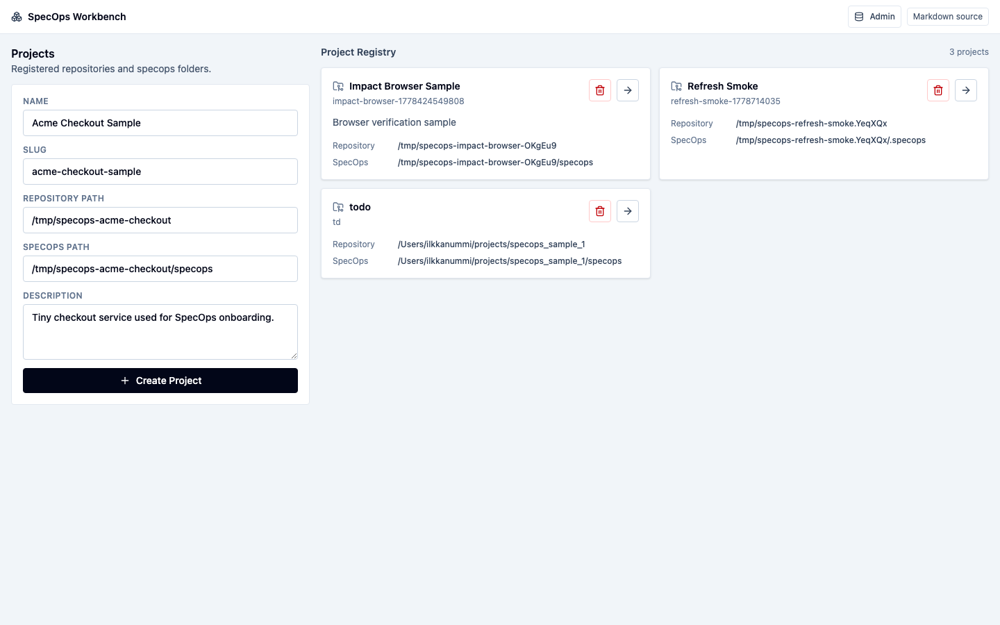
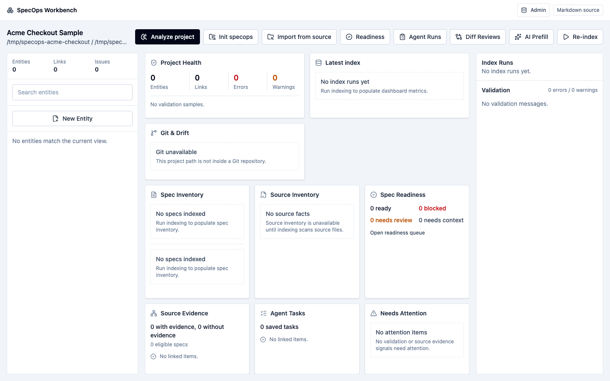
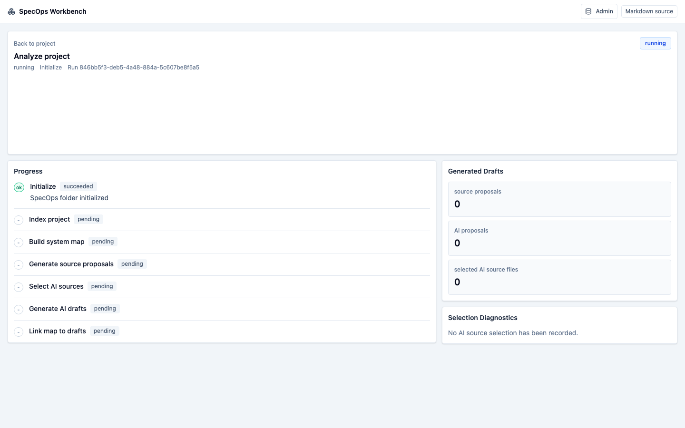
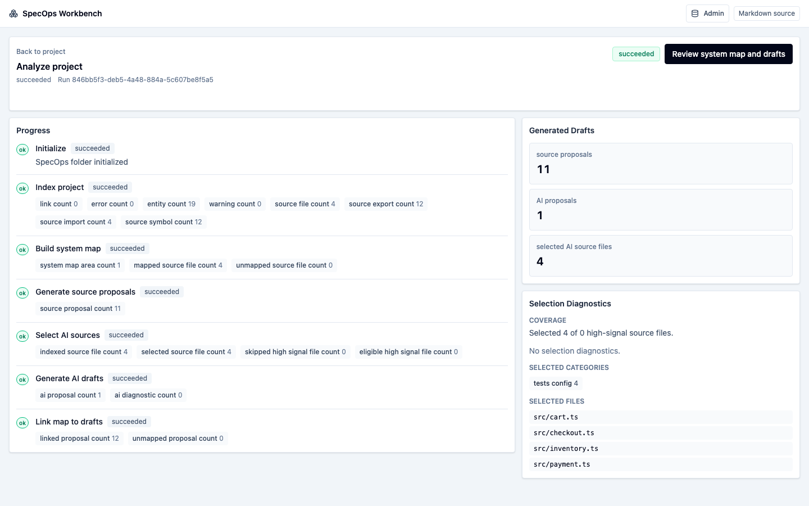
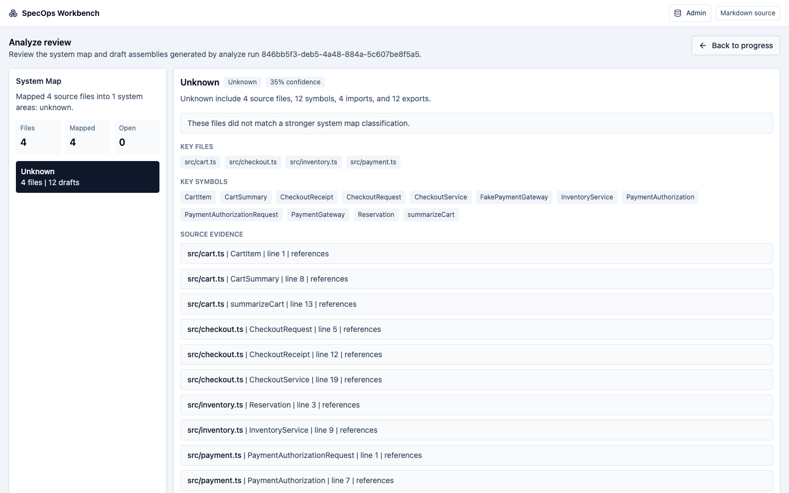
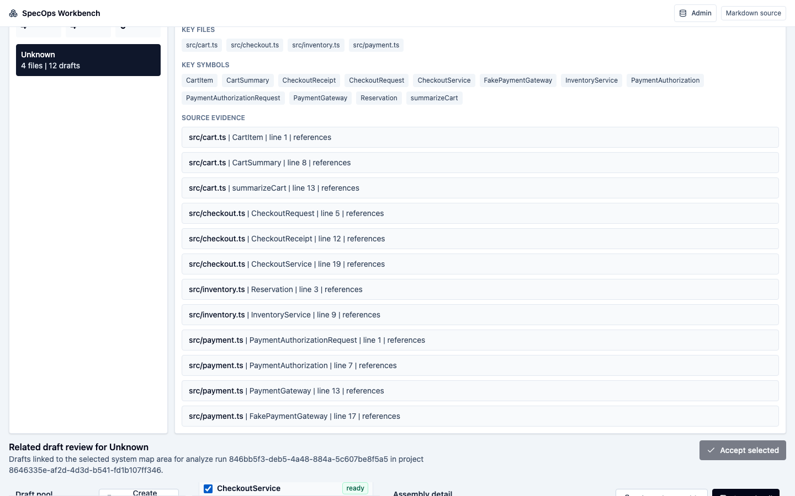
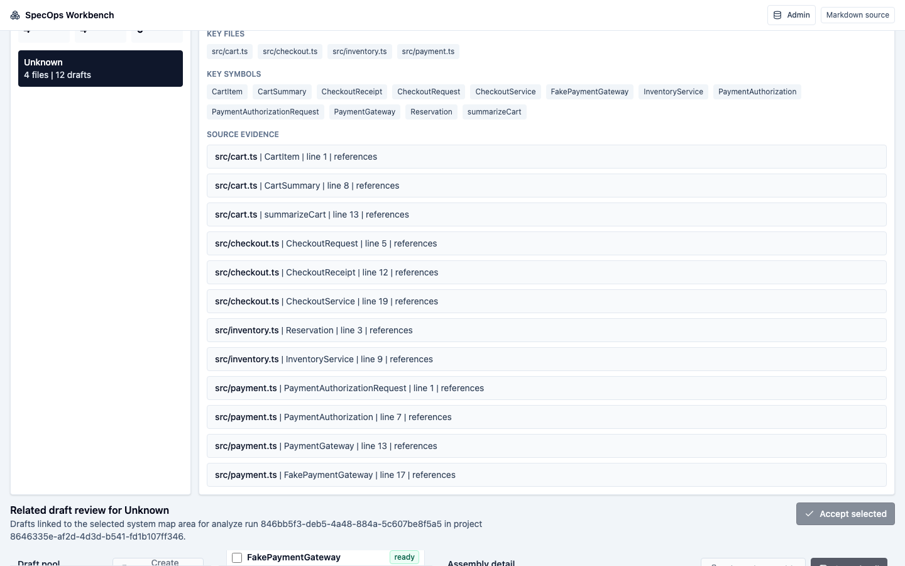
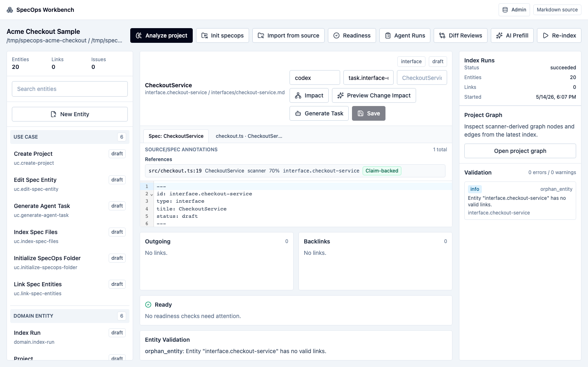
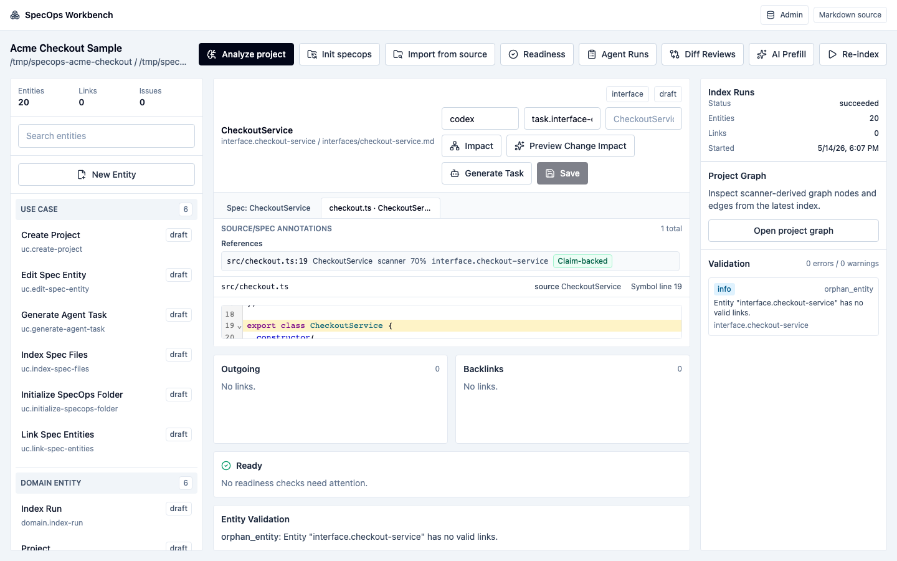

# Analyze Existing Project Walkthrough

This walkthrough starts with the tiny TypeScript project in
`examples/acme-checkout`, registers it in SpecOps Workbench, runs
**Analyze project**, reviews generated draft assemblies, accepts one base spec,
and verifies the resulting source links and source/spec annotations.

Use a disposable copy while learning so repeated Analyze Project runs start clean:

```sh
rm -rf /tmp/specops-acme-checkout
cp -R examples/acme-checkout /tmp/specops-acme-checkout
```

## 1. Start SpecOps

From the SpecOps repo root:

```sh
docker compose up -d postgres
cp .env.example .env
pnpm db:migrate
pnpm dev
```

If your Docker install exposes Compose as a separate binary, use
`docker-compose up -d postgres` instead.

Open `http://127.0.0.1:5176`.



## 2. Register the Existing Project

Create a project with these values:

```text
Name: Acme Checkout Sample
Slug: acme-checkout-sample
Repository Path: /tmp/specops-acme-checkout
SpecOps Path: /tmp/specops-acme-checkout/specops
Description: Tiny checkout service used for SpecOps onboarding.
```

After creation, the project opens with no entities because the sample has source
code but no specs yet.



## 3. Run Analyze Project

Click **Analyze project**. This is the normal starting flow for an existing
project without specs. It initializes the `specops/` folder, indexes source
files, generates source-derived draft proposals, builds a system map, and
prepares review assemblies.



When the run finishes, click **Review system map and drafts**.



## 4. Review Draft Assemblies

The review screen shows the system map, draft pool, assembly list, and selected
assembly detail. Source-derived proposals already include source evidence, so
ready assemblies can be accepted without inventing unsupported claims.



Select the `CheckoutService` assembly. It is ready because the generated fact
has source evidence from `src/checkout.ts`.



Click **Accept selected**. SpecOps writes the markdown spec under the sample
project's `specops/` folder, records source/spec annotations, and re-indexes the
project.



## 5. Inspect the Base Spec

Open `CheckoutService` from the project entity list. The accepted markdown is a
base-level spec: it captures the entity identity, reviewed fact, source evidence
footnote, and source link section.



Open the source tab for the entity, for example
**checkout.ts · CheckoutService**. The annotation panel lists the source file,
symbol, relationship type, provenance, and confidence. The source viewer opens
the linked source file at the evidence line.



At this point the project has:

- A reviewed base spec written from the Analyze Project workflow.
- Source links from the spec back to supporting source evidence.
- Source/spec annotations stored in the workbench.
- Indexed source evidence available from the entity detail view.

Use this as the starting point for tightening definitions, adding richer links,
and moving important entities from `draft` toward your project readiness bar.
